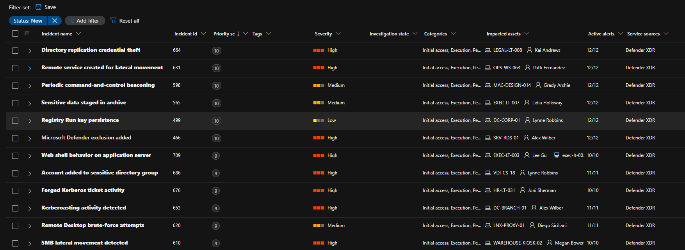
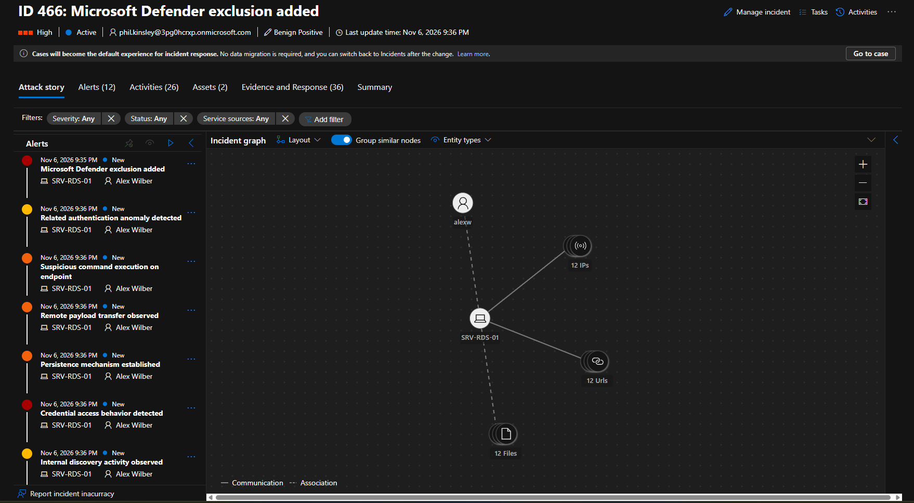

# Defender XDR Story Seeder

Current version: **0.2.4-beta**

Defender XDR Story Seeder creates a disposable, presentation-friendly incident dataset in the
Microsoft Defender portal without Microsoft Sentinel or a fleet of physical or virtual endpoints.
It uses Microsoft Graph to create manual alerts, groups 10–12 alerts into each incident, associates
tenant identities with fictional endpoint and mailbox assets, and records every created object in a
local run manifest.

Version 0.2 adds an interactive run planner and optional dormant AI-agent inventory. When supported
by the tenant, it creates Entra agent identity blueprints, blueprint principals, child agent
identities, and Agent 365 registry cards directly through Microsoft Graph. It then creates manual
Defender XDR proxy stories that carry those object identifiers in their narratives and evidence.

Version 0.2.1 corrects Agent Registry ownership payloads, captures complete Graph error details,
stops repeating a tenant-wide 401/403 registration failure, and adds a registration-only retry that
reuses existing identities and incidents.

Version 0.2.2 adds a dedicated agent-only cleanup launcher. It recursively discovers seeder
manifests, deduplicates their recorded object IDs, and also finds blueprint names using that
release's exact legacy prefix. It removes only those registrations, blueprints, child identities,
and blueprint principals without reading or changing Defender alerts or incidents.

Version 0.2.3 fixes single-page Agent ID blueprint discovery when Microsoft Graph correctly omits
the optional `@odata.nextLink` property.

Version 0.2.4 names new demo agents with the exact `[MXDR Demo]` prefix, securely reuses the
administrator's Microsoft Graph sign-in across seeding and cleanup processes, keeps AI stories
aligned when more AI incidents than demo agents are requested, and safely reconciles ambiguous
alert POST timeouts before continuing. Earlier packages retain their historical naming only inside
their archived ZIPs and changelog entries.

> This is a security-testing and demonstration utility. Run it only in a tenant where you are
> authorized to create hundreds of Defender alerts and incidents. A default run creates 50
> incidents and 549 alerts.

## Sample output

### Seeded incident queue

The full run produces varied incident names, severities, impacted identities, fictional endpoints,
and 10–12 active alerts per incident in the Microsoft Defender portal.



### Incident attack story

Opening a seeded incident shows its linked alert sequence and the relationships among the impacted
identity, fictional endpoint, IP addresses, URLs, and files.



## What the tool creates

| Item | Default | Details |
| --- | ---: | --- |
| Incidents | 50 | Unique attack stories with informational, low, medium, and high severities. |
| Alerts | 549 | Deterministic distribution of 10, 11, or 12 linked alerts per incident. |
| Attack stories | 50 | Email, identity, endpoint, cloud-app, Defender for Cloud, and hybrid scenarios. |
| Fictional endpoints | 60 | Rotated through incident evidence; no endpoint is enrolled or created in Entra ID. |
| Fictional mailboxes | 30 | Generated in the signed-in tenant domain; no Exchange object is created. |
| Tenant identities | Read dynamically | Enabled member users are randomized across impacted identity evidence. |
| Dormant demo AI agents | 10 when selected | Blueprints, principals, identities, and registry cards; no runtime or credential is created. |
| AI proxy incidents | Up to 10 by default | Part of the selected incident total, each still containing exactly 10–12 alerts. |

Alert titles do not contain a bracketed synthetic prefix. Created records are classified as
`informationalExpectedActivity` with the `securityTesting` determination. Every fifth incident is
resolved during creation so the resulting dataset includes both active and resolved examples.

## Important platform limitations

- Alert creation uses the Microsoft Graph **beta** manual-alert API. Beta APIs can change without
  notice and are not supported for production applications.
- Microsoft controls `serviceSource`, `detectionSource`, and product attribution. Manual alerts are
  shown truthfully as Microsoft Defender XDR / Manual; the script cannot impersonate Defender for
  Endpoint, Defender for Identity, Defender for Office 365, or Defender for Cloud.
- Fictional devices appear as incident evidence under **Artifacts > Assets**. They do not populate
  the tenant-wide **Assets > Devices** inventory. That inventory requires onboarding or discovery.
- Microsoft Graph does not expose a supported delete method for these alert and incident records.
  Cleanup resolves and classifies them; it does not erase history.
- Manual alerts cannot become native Security for AI detections and Graph manual-alert entities do
  not support an AI-agent asset type. AI stories therefore declare `associationMode: manualProxy`
  and `agentAssetLinked: false`; IDs in the story are traceable references, not a claimed native
  portal relationship.
- Agent risk labels are calculated by Microsoft security products. The script can declare varied
  least-privilege profiles but cannot set a Defender risk value or guarantee that a dormant agent is
  evaluated. Agent 365 and Security for AI licensing and rollout still control portal visibility.

See [Architecture and data flow](docs/ARCHITECTURE.md) for the implementation details.

## Requirements

- PowerShell 7.2 or later (`pwsh`)
- A Microsoft 365 tenant with Microsoft Defender XDR access
- Interactive sign-in by an account allowed to grant or use the delegated permissions below
- A supported Defender role for alert and incident operations; Microsoft documents **Security
  Operator** and **Security Administrator** for the write operations
- Internet access to Microsoft Graph and PowerShell Gallery on first run

The launcher installs `Microsoft.Graph.Authentication` for the current user if it is not already
available. It does not install the full Microsoft Graph PowerShell SDK.

### Delegated Microsoft Graph permissions

| Permission | Seeder | Cleanup | Purpose |
| --- | :---: | :---: | --- |
| `SecurityAlert.Create.All` | Yes | No | Create manual security alerts. |
| `SecurityIncident.ReadWrite.All` | Yes | Yes | Read/update the newly created incidents and close seeded incidents. |
| `User.Read.All` | Yes | No | Read enabled member identities for randomized impacted-user evidence. |
| `SecurityAlert.ReadWrite.All` | Yes | Yes | Seed-time consent allows later cleanup to reuse the same cached sign-in. |
| `AgentIdentityBlueprint.Create` | Optional | No | Create a sponsored dormant blueprint. |
| `AgentIdentityBlueprintPrincipal.Create` | Optional | No | Create its blueprint principal. |
| `AgentIdentity.Create.All` | Optional | No | Create a child agent identity where supported. |
| `AgentRegistration.ReadWrite.All` | Optional | Yes | Create/delete the recorded Agent 365 registry card. |
| `AgentIdentityBlueprint.Read.All` | Optional | Agent-only | Discover blueprints whose name begins with the exact cleanup prefix. |
| `AgentIdentityBlueprint.DeleteRestore.All` | Optional | Yes | Soft-delete only recorded generated blueprints; child identities are cascade-cleaned. |
| `AgentIdentity.DeleteRestore.All` | Optional | Agent-only | Remove a recorded child identity if cascade cleanup has not already removed it. |
| `AgentIdentityBlueprintPrincipal.DeleteRestore.All` | Optional | Agent-only | Remove a recorded blueprint principal if cascade cleanup has not already removed it. |

The scripts use delegated browser sign-in. They do not accept or store client secrets, certificates,
or passwords. Microsoft Graph securely caches the delegated sign-in for the current Windows user,
refreshes it when needed, and makes it available to later PowerShell processes. The scripts verify
the requested administrator and required scopes before reuse and do not call `Disconnect-MgGraph`.
Run `Disconnect-MgGraph` yourself when you intentionally want to end the cached session. Microsoft
Graph documentation:

- [Create a manual alert (beta)](https://learn.microsoft.com/graph/api/security-alert-post-manualalert?view=graph-rest-beta)
- [Update an alert](https://learn.microsoft.com/graph/api/security-alert-update?view=graph-rest-1.0)
- [Update an incident](https://learn.microsoft.com/graph/api/security-incident-update?view=graph-rest-1.0)
- [List users](https://learn.microsoft.com/graph/api/user-list?view=graph-rest-1.0)
- [Create an agent identity blueprint](https://learn.microsoft.com/graph/api/agentidentityblueprint-post?view=graph-rest-1.0)
- [Create an agent registration (beta)](https://learn.microsoft.com/microsoft-365/copilot/extensibility/api/admin-settings/agent-registration/agentregistration-create)

## Install

Download the source archive or a versioned release archive, extract it, and open PowerShell in the
`defender-xdr-story-seeder` directory. Verify the release checksum before running the scripts.

Windows may mark downloaded scripts as originating from the internet. If execution is blocked,
inspect the files and then unblock only this extracted package:

```powershell
Get-ChildItem -LiteralPath . -Filter '*.ps1' | Unblock-File
```

## Quick start

Only the administrator UPN is required. The launcher asks for an incident count (default `50`),
whether to create demo AI agents (default yes), an agent count (default `10`), and the number of AI
proxy incidents (default is the smaller of the agent and incident counts):

```powershell
pwsh -File .\Start-DefenderBulkSeed.ps1 'global.admin@contoso.com'
```

Press Enter at every prompt for 50 incidents, 549 alerts, 10 dormant agents, and 10 AI proxy
incidents. The final confirmation states all exact totals before sign-in writes begin.

If more AI incidents than agents are selected, the incidents cycle through the selected agent pool.
For example, three agents and six AI incidents use agents 1, 2, 3, 1, 2, and 3 while retaining the
matching story profile for each association.

To bypass the incident-count question while retaining the remaining prompts:

```powershell
pwsh -File .\Start-DefenderBulkSeed.ps1 'global.admin@contoso.com' -IncidentCount 12
```

For a fully parameterized run:

```powershell
pwsh -File .\Start-DefenderBulkSeed.ps1 'global.admin@contoso.com' `
  -IncidentCount 12 -CreateDemoAiAgents -DemoAgentCount 3 -AiIncidentCount 6
```

To keep the traditional-only behavior:

```powershell
pwsh -File .\Start-DefenderBulkSeed.ps1 'global.admin@contoso.com' -SkipDemoAiAgents
```

The default confirmation includes:

```text
Create 50 incidents containing exactly 549 alerts, plus 10 dormant demo AI agents; 10 incident(s) will use manual AI proxy stories
```

If a launcher says `Create 3 synthetic alerts and one incident`, stop it. That message belongs to an
obsolete proof-of-concept package, not this version.

For an environment where the embedded browser cannot be used:

```powershell
pwsh -File .\Start-DefenderBulkSeed.ps1 'global.admin@contoso.com' -UseDeviceCode
```

## Smaller runs and previews

Create ten incidents instead of fifty:

```powershell
pwsh -File .\Start-DefenderBulkSeed.ps1 'global.admin@contoso.com' -IncidentCount 10
```

Preview the deterministic plan without signing in or changing the tenant:

```powershell
pwsh -File .\Invoke-DefenderBulkSeeder.ps1 `
  -GlobalAdminUpn 'global.admin@contoso.com' `
  -IncidentCount 10
```

The preview reports each catalog number, incident title, severity, fictional endpoint, and alert
count.

## Resume a partial run

The seeder writes a schema-3 manifest before and after each alert POST. If a run stops, use the
latest `artifacts\bulk-seed-run-*.json` file with the same counts. Completed incidents and recorded
agent objects are reused, while a partial incident resumes at its first unrecorded alert.

```powershell
pwsh -File .\Invoke-DefenderBulkSeeder.ps1 `
  -GlobalAdminUpn 'global.admin@contoso.com' `
  -IncidentCount 50 `
  -CreateDemoAiAgents -DemoAgentCount 10 -AiIncidentCount 10 `
  -ResumeManifestPath '.\artifacts\bulk-seed-run-20261109-120000.json' `
  -Execute
```

Each alert description contains a deterministic correlation marker. When a POST returns `408`,
`429`, a server error, or loses its response, the seeder checks the incident and recent alerts for
that marker for up to one minute. If the alert exists, its response is reconstructed and the run
continues without another POST. If it does not appear, the POST is retried once. If the process
stops between submission and manifest update, resuming performs the same reconciliation before
continuing the existing incident. Partial schema-2 manifests from the earlier 0.2.4 build are
refused because they do not contain safe correlation markers.

## Retry Agent 365 registration without creating duplicates

If a 0.2.0 run created blueprints, principals, and child identities but Agent Registry returned
`403 Forbidden`, use the 0.2.1 retry launcher. Supply the original manifest as the second argument:

```powershell
pwsh -File .\Start-DefenderAgentRegistrationRetry.ps1 `
  'global.admin@contoso.com' `
  'C:\path\to\bulk-seed-run-20261109-170925.json'
```

The retry requests only `AgentRegistration.ReadWrite.All` and `User.Read`. It verifies that the
registration permission is present in the token, updates the original manifest after every agent,
and records the full HTTP status and Graph response for any remaining failure. It does not recreate
blueprints, principals, identities, incidents, or alerts. If the manifest already lives under this
package's `artifacts` directory, omit the second argument to use the newest seed manifest.

## Delete only the demo agents

To remove every agent object recorded by seeder manifests anywhere under Downloads, while leaving
all Defender alerts and incidents alone, run:

```powershell
pwsh -File .\Start-DefenderAgentCleanup.ps1 `
  'global.admin@contoso.com' `
  "$env:USERPROFILE\Downloads"
```

The second argument is searched recursively for `bulk-seed-run-*.json`. The cleanup deduplicates
copied manifests and targets recorded Agent 365 registration, blueprint, child-identity, and
blueprint-principal IDs. It also lists Agent ID blueprints and adds only those whose display name
starts with the exact `[MXDR Demo]` prefix, catching a run whose manifest was misplaced. A
confirmation displays the selected agent sets and object IDs before deletion.

To preview one manifest without signing in or changing the tenant:

```powershell
pwsh -File .\Invoke-DefenderAgentCleanup.ps1 `
  -GlobalAdminUpn 'global.admin@contoso.com' `
  -ManifestPath 'C:\path\to\bulk-seed-run-20261109-170925.json'
```

Blueprint deletion is a Microsoft Graph soft delete and triggers Microsoft's cascade cleanup of
child objects. The script also attempts each recorded child identity and principal directly; a
`404 Not Found` is treated as an already-completed deletion, so rerunning is safe. Results are saved
to `artifacts\agent-cleanup-run-*.json`.

## Clean up before another run

Resolve only the active alerts that match this package's catalog and close the safe incidents:

```powershell
pwsh -File .\Start-DefenderBulkCleanup.ps1 'global.admin@contoso.com'
```

The cleanup utility:

1. Reads all active Defender alerts available through the tenant retention window.
2. Selects Manual alerts whose normalized title matches the current 50 catalog titles, the shared
   attack-stage titles, or the three legacy proof-of-concept titles.
3. Recognizes and removes the obsolete `[SYNTHETIC]` or `[SYNTHESIZED]` prefix only for matching.
4. Resolves each selected alert as `informationalExpectedActivity` / `securityTesting`.
5. Closes an incident only when it has no unrelated active alert and every selected alert update for
   that incident succeeded.
6. Records successes, failures, and protected incidents in `artifacts\cleanup-run-*.json`.
7. Reads only IDs recorded in seed manifests, removes matching Agent 365 registrations, and
   soft-deletes matching blueprints. Blueprint deletion triggers Microsoft-managed cleanup of child
   identities and principals. It never discovers and deletes unrelated agents by name.

Preview the cleanup without making changes:

```powershell
pwsh -File .\Invoke-DefenderBulkCleanup.ps1 `
  -GlobalAdminUpn 'global.admin@contoso.com'
```

`-AllManualAlerts` is intentionally available only on the underlying cleanup script. It selects
every active Manual alert, including alerts created by other people or tools, and should normally be
avoided.

## Parameter reference

### `Start-DefenderBulkSeed.ps1`

| Parameter | Default | Description |
| --- | --- | --- |
| `GlobalAdminUpn` | Required | Login hint used for delegated sign-in. |
| `IncidentCount` | `50` | Number of catalog incidents to create, from 1 through 50. |
| `CreateDemoAiAgents` | Prompt | Answer yes without prompting; mutually exclusive with `SkipDemoAiAgents`. |
| `SkipDemoAiAgents` | Prompt | Keep the run traditional-only without prompting. |
| `DemoAgentCount` | `10` | Number of dormant demo identity sets, from 1 through 50. |
| `AiIncidentCount` | `min(agents, incidents)` | Number of selected incidents using AI proxy scenarios. |
| `ResumeManifestPath` | Empty | Continue a matching schema-3 manifest, including its partial incident. |
| `UseDeviceCode` | Off | Use device-code authentication instead of interactive browser sign-in. |

### `Invoke-DefenderBulkSeeder.ps1`

| Parameter | Default | Description |
| --- | --- | --- |
| `GlobalAdminUpn` | Required | Login hint for delegated authentication. |
| `IncidentCount` | `50` | Number of incidents to plan or create. |
| `CreateDemoAiAgents` | Off | Attempt supported Entra/Agent 365 creation APIs. |
| `DemoAgentCount` | `10` | Number of demo agents to attempt. |
| `AiIncidentCount` | `0` | Number of AI manual proxy incidents within the total. |
| `AiAgentCatalogPath` | `catalog\ai-agent-catalog.json` | Alternate AI profiles and scenarios. |
| `ResumeManifestPath` | Empty | Resume the same schema-3 plan and partial incident using identical counts. |
| `StartAt` | `1` | One-based catalog item at which to begin. |
| `DelayMilliseconds` | `1000` | Delay between write operations; accepted range is 500–30000. |
| `RandomSeed` | `20261106` | Makes identity, mailbox, and endpoint assignment repeatable. |
| `CatalogPath` | `catalog\attack-catalog.json` | Alternate attack catalog. |
| `EndpointRosterPath` | `catalog\endpoint-roster.json` | Alternate fictional endpoint roster. |
| `MailboxRosterPath` | `catalog\mailbox-roster.json` | Alternate fictional mailbox roster. |
| `Execute` | Off | Make tenant changes; without it the script produces a local preview. |
| `UseDeviceCode` | Off | Use device-code authentication. |
| `OutputDirectory` | `artifacts` | Local directory for run manifests. |

### `Invoke-DefenderBulkCleanup.ps1`

| Parameter | Default | Description |
| --- | --- | --- |
| `GlobalAdminUpn` | Required | Login hint for delegated authentication. |
| `CatalogPath` | `catalog\attack-catalog.json` | Catalog used to recognize seeded alert titles. |
| `AiAgentCatalogPath` | `catalog\ai-agent-catalog.json` | Catalog used to recognize AI proxy alert titles. |
| `SeedManifestPath` | All local seed manifests | Restrict agent cleanup to one manifest. |
| `SkipDemoAgentCleanup` | Off | Resolve alerts/incidents without removing recorded agents. |
| `DelayMilliseconds` | `500` | Delay between update operations; accepted range is 0–5000. |
| `IncludeLegacyPoc` | `true` | Recognize the three older proof-of-concept alert titles. |
| `AllManualAlerts` | Off | Select all active Manual alerts; potentially destructive to unrelated demos. |
| `Execute` | Off | Apply updates; without it the script is a preview. |
| `UseDeviceCode` | Off | Use device-code authentication. |
| `OutputDirectory` | `artifacts` | Local directory for cleanup manifests. |

### `Start-DefenderAgentRegistrationRetry.ps1`

| Parameter | Default | Description |
| --- | --- | --- |
| `GlobalAdminUpn` | Required | Login hint used for delegated sign-in. |
| `ManifestPath` | Newest local seed manifest | Existing 0.2 manifest containing agent IDs. |
| `UseDeviceCode` | Off | Use device-code authentication. |

### `Start-DefenderAgentCleanup.ps1`

| Parameter | Default | Description |
| --- | --- | --- |
| `GlobalAdminUpn` | Required | Login hint used for delegated sign-in. |
| `SearchRoot` | Local `artifacts` folder | Folder recursively searched for seed manifests, or one manifest file. |
| `ManifestPath` | Empty | Additional explicit seed manifest paths. |
| `NamePrefix` | `[MXDR Demo]` | Exact beginning of blueprint names additionally selected by the launcher. |
| `UseDeviceCode` | Off | Use device-code authentication. |

## Run manifests and privacy

Manifests can contain tenant IDs, administrator UPNs, discovered user UPNs, mailbox addresses,
incident IDs, alert IDs, and Defender portal URLs. They are deliberately stored beneath
`artifacts\`, which is excluded from source control. Treat manifests as tenant data:

- do not attach them to public issues;
- do not commit them to Git;
- redact tenant and user identifiers before sharing troubleshooting excerpts; and
- delete local copies according to your organization's retention requirements.

The scripts never send manifest data anywhere except Microsoft Graph operations required for the
selected tenant.

## Catalog customization

Catalog and roster files are ordinary JSON:

- `catalog/attack-catalog.json` contains 50 attack definitions.
- `catalog/endpoint-roster.json` contains 60 fictional endpoint identities.
- `catalog/mailbox-roster.json` contains 30 fictional shared-mailbox aliases.
- `catalog/ai-agent-catalog.json` contains 10 dormant agent profiles and AI proxy scenarios.

Keep all evidence fictional and use documentation-reserved IP address ranges and domains. Run the
offline validation after any edit:

```powershell
pwsh -File .\tests\Offline.Tests.ps1
```

See [Catalog and evidence model](docs/CATALOG.md) before adding new entity types or changing the
fixed 50-incident release contract.

## Build a versioned release archive

From the project directory:

```powershell
pwsh -File .\Build-Release.ps1
```

The builder validates scripts and catalogs, then writes a ZIP and `SHA256SUMS.txt` under `dist\`.
The version comes from `VERSION`; the committed scripts and changelog must use the same version.

## Documentation

- [Architecture and data flow](docs/ARCHITECTURE.md)
- [Agent 365 and Security for AI behavior](docs/AGENT365.md)
- [Catalog and evidence model](docs/CATALOG.md)
- [Troubleshooting](docs/TROUBLESHOOTING.md)
- [Changelog](CHANGELOG.md)
- [Security guidance](SECURITY.md)

## License and status

This project is licensed under the repository's GNU General Public License, version 3. Microsoft
product names identify the services used and do not imply Microsoft affiliation or endorsement.

Version `0.2.4-beta` is suitable for authorized demonstrations and lab tenants. It is not a
production telemetry simulator or a substitute for real Defender workload onboarding.


